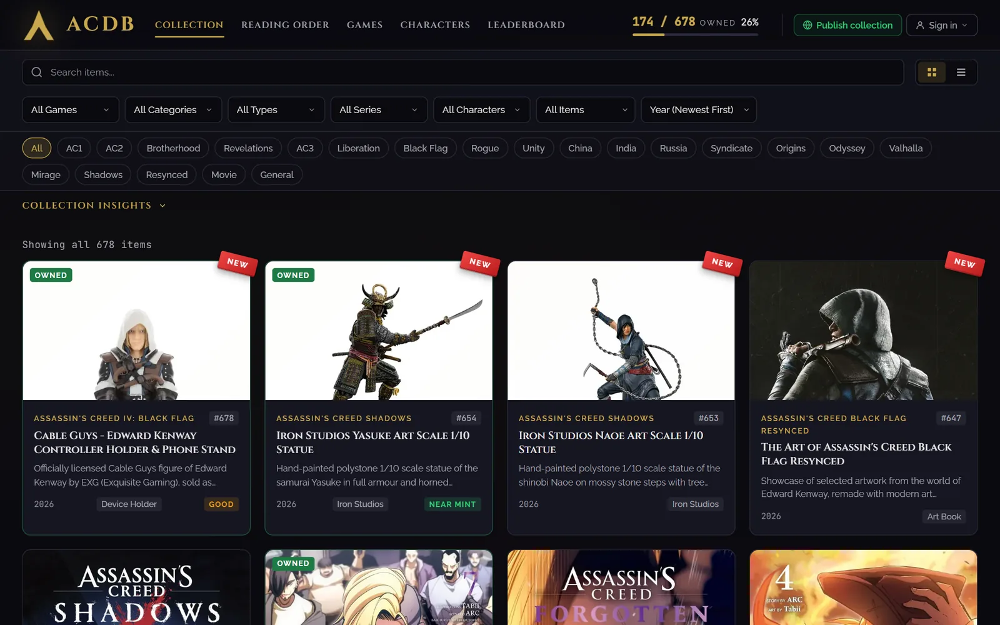
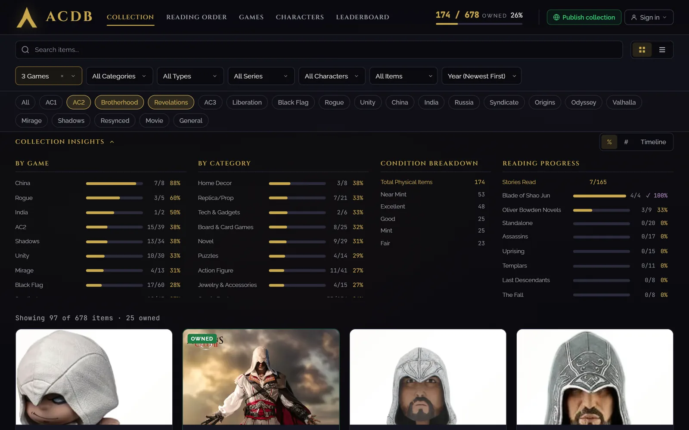
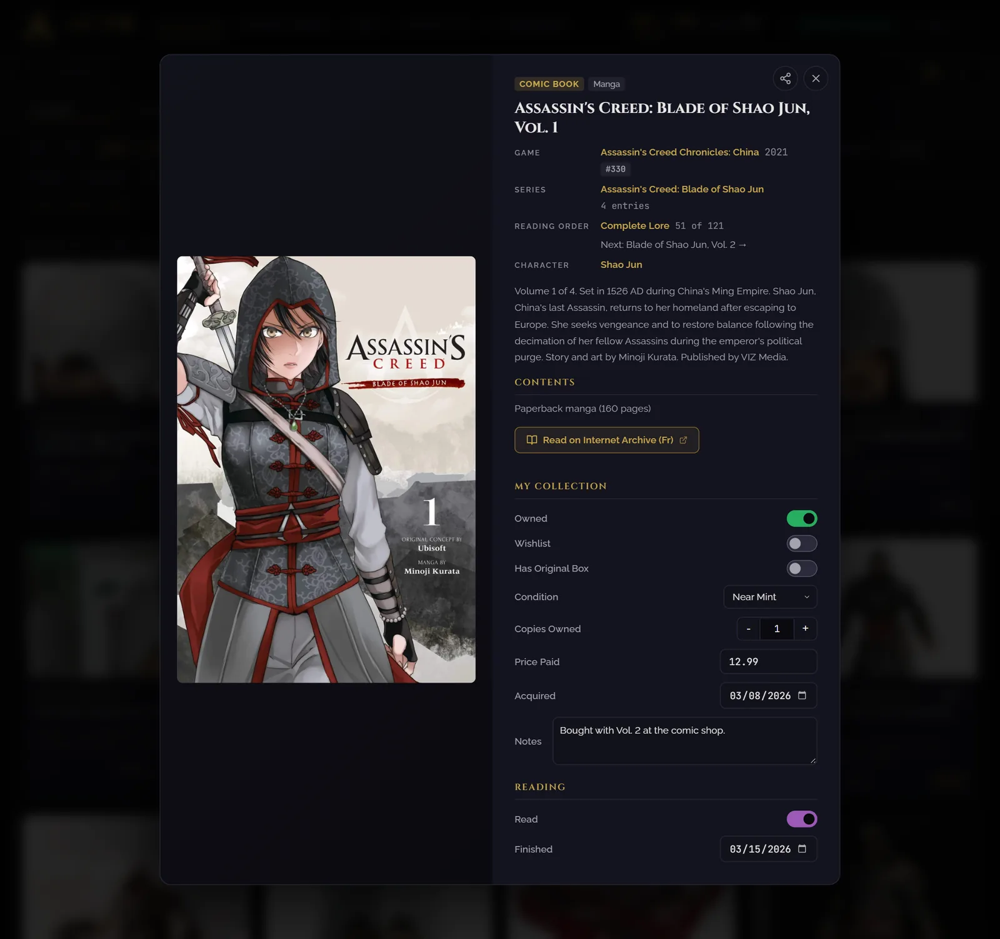
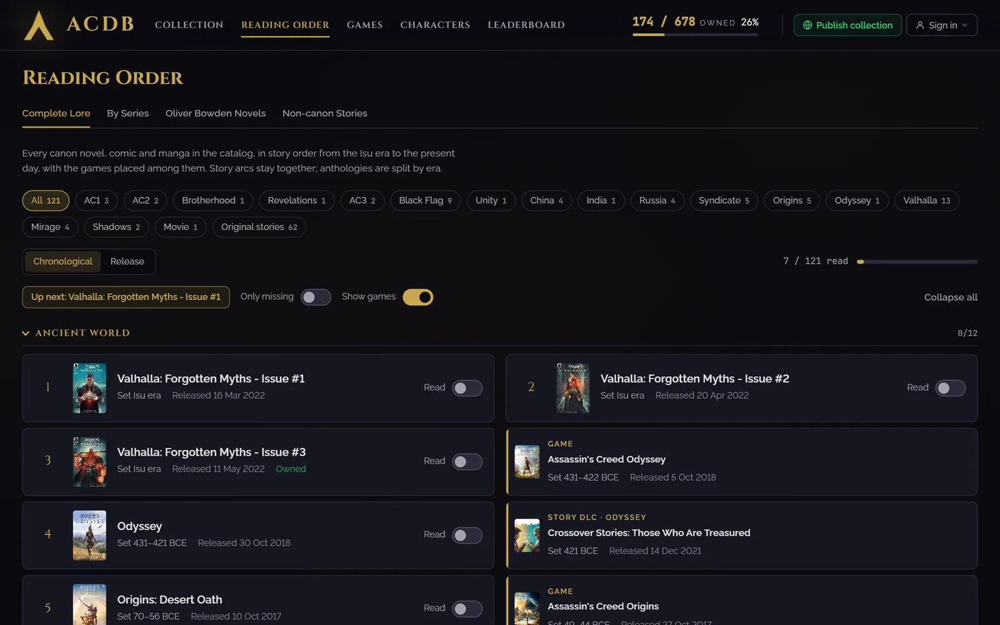
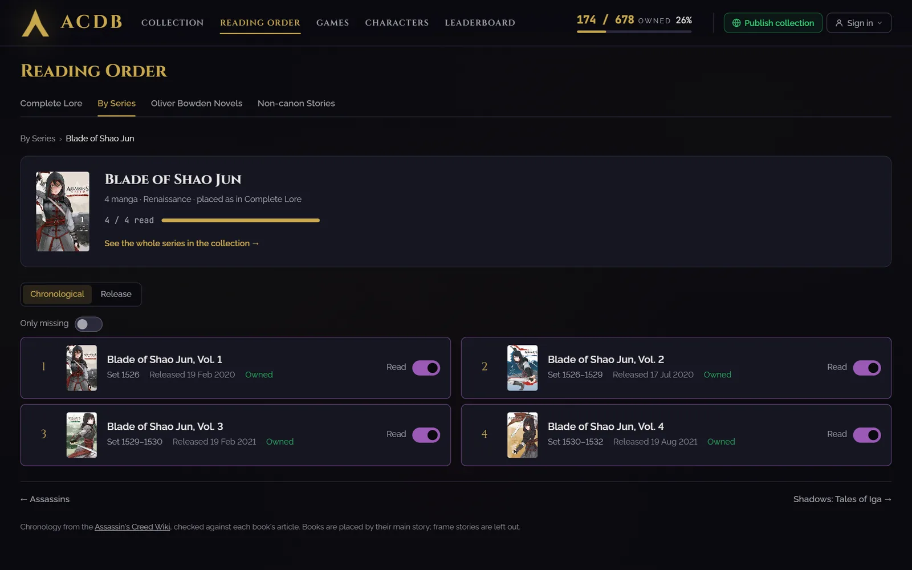
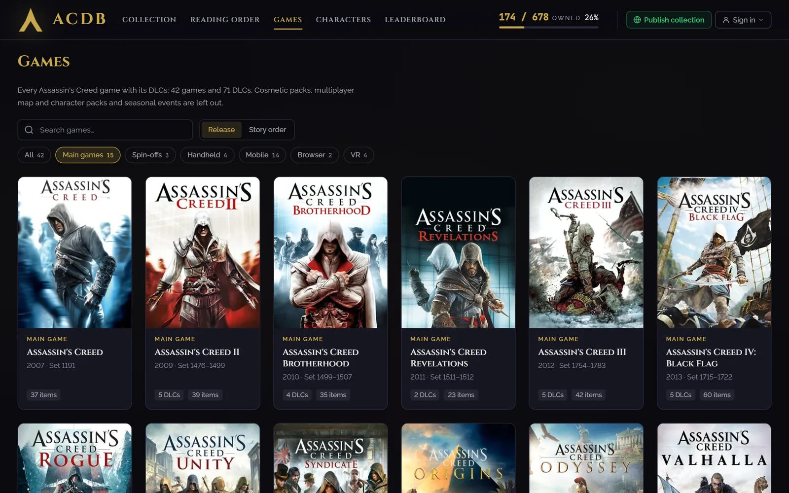
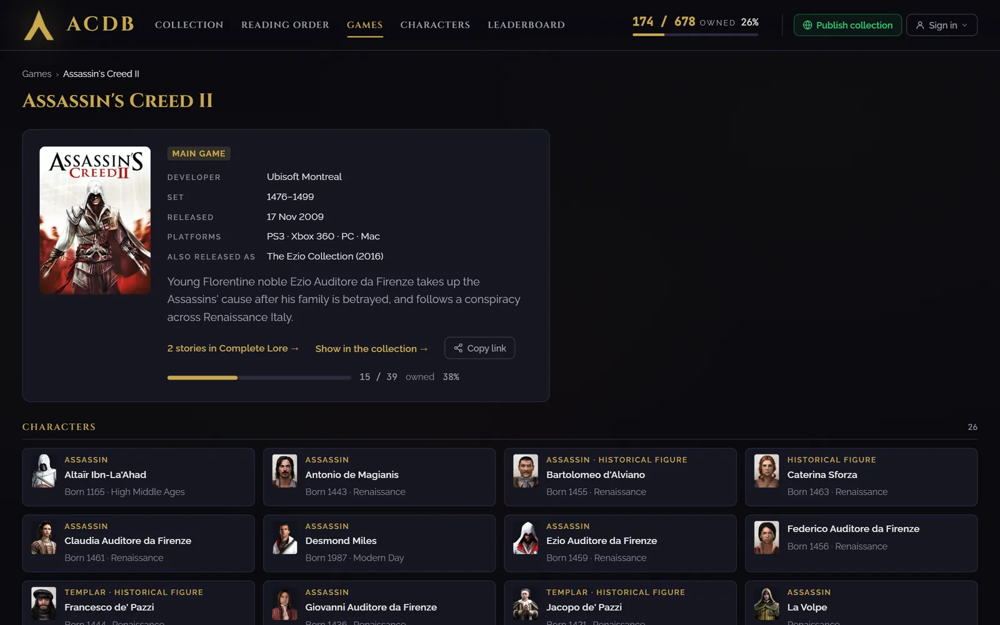
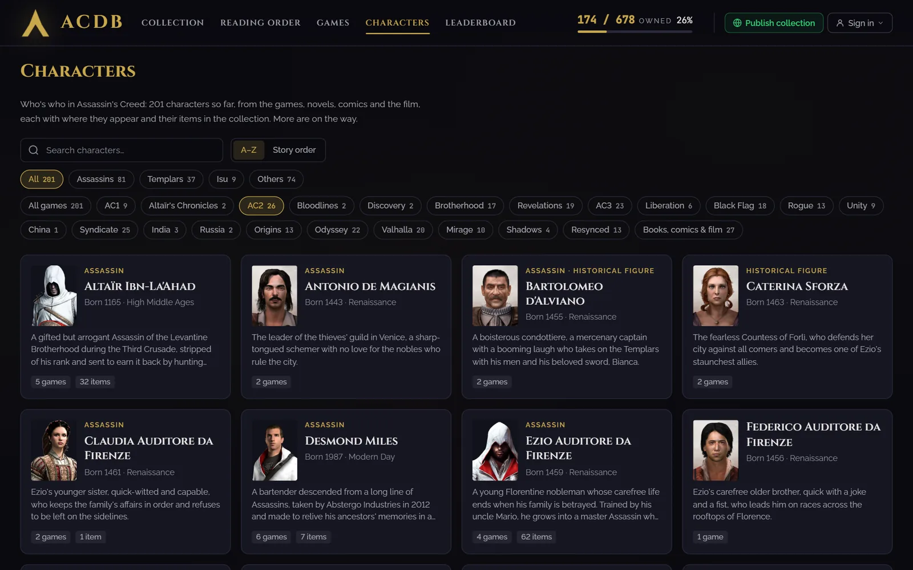
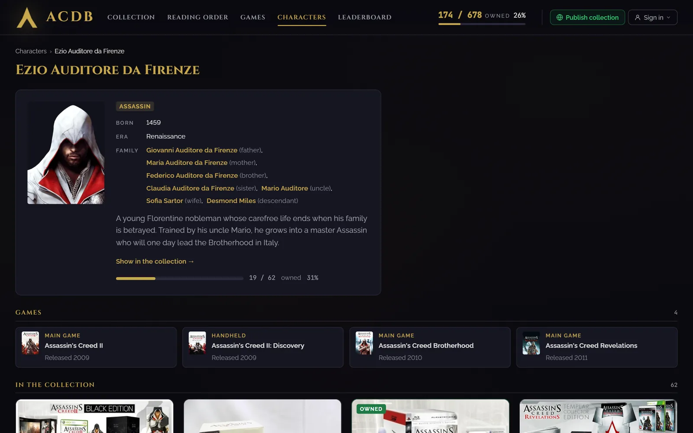
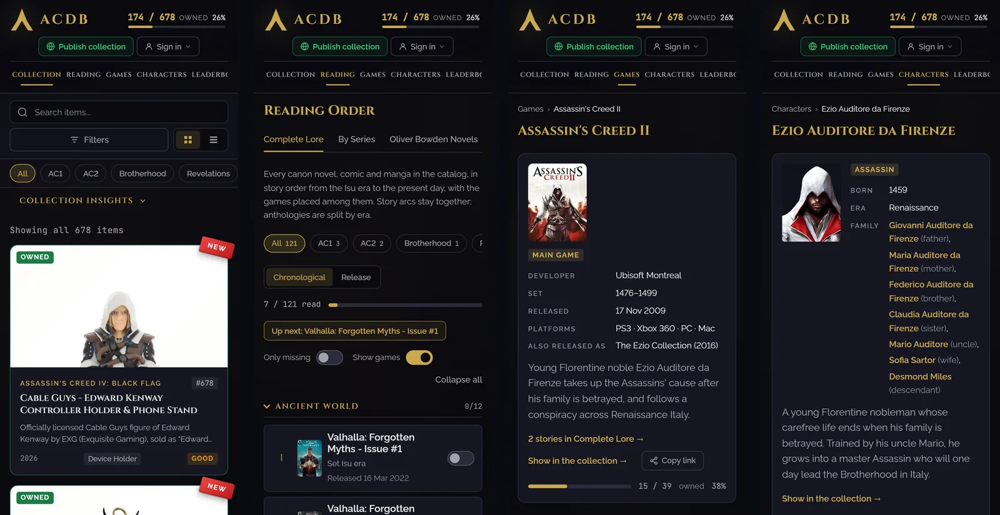

# ACDb - Assassin's Creed Collector's Database

A fan-made collection tracker for official Assassin's Creed collectibles. Browse, search, and track your collection right in your browser, or sign in with Google to see it on any device. Share your progress and compete on the leaderboard.

**Live site:** [acdb.theprivategeek.com](https://acdb.theprivategeek.com)

<p>
  
</p>

## Features

- **680+ officially licensed items** — statues, figurines, action figures, collector's editions, art books, novels, comic books, steelbooks, replicas, board games and puzzles, vinyl soundtracks, drinkware, jewelry, and more
- **Collection tracking** — mark items as owned, wishlist, track condition, number of copies, original box status, purchase price, acquisition date, and personal notes
- **Smart field logic** — setting condition or copies automatically marks as owned; clearing ownership resets all fields
- **Header at a glance** — tabs for **Collection**, **Reading Order**, **Games**, **Characters** and **Leaderboard** (on phones the row of tabs swipes sideways); a progress meter with owned / total and your completion % (click it to show only what you own); and one account menu for signing in, your public profile, back up / restore and the privacy policy
- **Grid and list views** — browse as a card grid or as a compact list (about twice as many items per screen). Sort by year, name or recently added, and show all items, owned, not owned, missing stories, wishlist, read or not read. **Missing Stories** lists the novels, comics and manga you have in no edition, each story once: owning a collected edition covers the issues it collects (`collects`), and an edition you own part of drops out while its missing parts show on their own. The four newest items wear a NEW sticker, and every card and item window shows the item's permanent id (`#14`) on its game line. Cards and reading-order covers load a small copy of the item's photo, so scrolling the whole catalog downloads about a third of what it used to; the item window shows the full photos
- **Item card** — full details, photos, your collection fields and, for books, reading status and reading order position. Items that show a character link to that character's page. The category, type, game and series in the card are one-click filters; opened from the Reading Order, Games or Characters tabs, the game links to its page and the series to its page in By Series instead. The share and close buttons stay in reach while you scroll
- **Cloud sync (optional)** — sign in with Google to keep your collection in your account and see it on every device you use. Changes sync within seconds, work offline and catch up later, and signing out clears the browser you used
- **Publish your collection** — get a public profile page (unique URL and display name) and a spot on the leaderboard. When you're signed in, your profile updates automatically
- **Collector's Leaderboard** — see how your collection stacks up against the top 100 collectors, ranked by items owned, and open anyone's public profile to browse what they own. Each collector is a card with their rank, item count, completion and a progress bar, in one centred column
- **Cascading filters** — multi-select by game, category, type, series and character. Filters cascade: selecting a game narrows categories, selecting a category narrows types, selecting a type narrows series, and the Characters list only offers the characters shown by the items above it (pick Valhalla and it lists Valhalla's). Its search ignores accents and knows other names ("connor" finds Ratonhnhaké:ton), and picking two characters shows the items with either. A character's page has a "Show in the collection" link that opens the grid filtered to them. Filters persist across page reloads, and any filter you've set is outlined in gold so you can see at a glance what's narrowing the list
- **Series browsing** — comics, graphic novels, manga, novel lines, and the Hachette partwork carry a `series` field (e.g. *Assassin's Creed: Assassins*) that groups single issues with the trade paperbacks that collect them, and can span types (the *Last Descendants* novels and the *Locus* comic share one series). The Series dropdown only appears when the current selection contains series items, and the series line in an item's card is a one-click filter to the whole run
- **Read online** — comics, graphic novels, and manga with a free scan in the [Internet Archive's Assassin's Creed anthology](https://archive.org/details/assassins-creed-graphic-novels-and-comics-anthology) show a "Read on Internet Archive" button in their item card. The entry's optional `read` field holds the book's path inside that collection, unencoded as the archive names it (e.g. `07. AC Templars/AC Templars 2016 (3)`), and `readUrl` in `js/utils.js` builds the link; a full `https://` URL is used as-is for books hosted elsewhere. An optional `readLang` (e.g. `"fr"`) marks a scan in a different language and adds a tag such as "(Fr)" to the button. collected editions only get one when the archive holds a scan of the collection itself, not just its single issues
- **Reading tracker** — novels, comic books, graphic novels, manga, and gamebooks get a Reading section in their item card: mark them as read (with an optional finished date), whether or not you own them. Read items get a badge, the status filter has "Read" / "Not Read" options, and Collection Insights shows your progress per series. Collected editions carry a `collects` list of the items they reprint, so marking a trade paperback read also marks its issues read (never the other way round, and unmarking it changes nothing) Which types count is `READABLE_TYPES` in `js/utils.js`
- **Reading order** — a "Reading Order" view (the Reading Order tab in the header, `#reading`) lists curated orders with a Chronological / Release toggle, read switches, an "Up next" shortcut and an "Only missing" switch that hides the books you have in any edition (a book you own only in a collected edition says "Owned in <edition>"). **Complete Lore** covers every canon novel, comic and manga in story order (120 entries, grouped under era headings that fold; all start open, with Collapse all / Expand all); a game filter narrows it to the stories tied to one game (`#reading/complete/valhalla`) or to the original stories not tied to any game. **By Series** (`#reading/series`) lists every series in the orders with your read progress (series under way first, under "Continue reading"); each series opens as its own page (`#reading/series/uprising`) under a "By Series › Uprising" breadcrumb, with a header card (first cover, types, era range, the collected editions that reprint its books, progress, "Up next" and a link to the whole series in the collection), its books placed as in Complete Lore, and links to the series before and after it. Series pages are derived from the orders and the items' `series` field, so they need no data of their own. Complete Lore places the games among the books as unnumbered rows (a "Show games" switch hides them), and a DLC set in another period than its game (Freedom Cry, Jack the Ripper, Wrath of the Druids) gets a row of its own; a game row links to the game's page and has a **Played** switch where a book has Read, so the list doubles as a checklist of the whole story (see **Games**). There are also the **Oliver Bowden Novels** (also the Bowden series' page) and **Non-canon Stories**. Books in an order show their position and the next book in their item card. Orders live in `js/reading-orders.js`: each entry is an item id, the start year and in-universe setting of its main story, and its earliest release date; the list order is the chronological order. Placement rules: a unit sits where its main historical story happens, story arcs stay together in issue order, anthologies split by era, and collected editions that only reprint issues are left out
- **Games** — a Games tab in the header (`#games`) lists every released Assassin's Creed game with its DLCs (expansions, story missions, game modes and Discovery Tours; cosmetic packs, multiplayer map and character packs and seasonal events are left out). **Release** order is a grid of box-art cards; **Story order** is a timeline under era headings, where a DLC set in another period than its game gets a row of its own. Search (it ignores accents, so "ragnarok" finds Dawn of Ragnarök) and kind chips (main games, spin-offs, handheld, mobile, browser, VR) narrow the list; the tab opens on the main games, with All one chip away. A card opens the game's page (`#games/assassins-creed-valhalla`): box art, developer, setting, release date, platforms, re-releases such as The Ezio Collection, its remake or original, a short spoiler-free description, links to its stories in Complete Lore and to the collection, how many of its items you own, its characters (each a link to their page; on phones a long cast folds behind "Show all"), its DLCs grouped by type, its items as the collection's own cards (they open over the page) and links to the games before and after it. Mark a game as **Played** on its page, with the date you finished it, and tick off each DLC in its list ("3 / 12 DLCs played"); played games get a purple edge and a Played badge on their cards, and a bar over the list counts the games shown that you've played ("4 / 15 played"). Played games are kept like the collection: in this browser, synced to your account when you're signed in, and in your backups. Back from a game's page returns you to where you were, whether that was the Games tab, a spot deep in Complete Lore or a character's page. Games aren't catalog items: they live in `js/games.js` with permanent ids (games and DLCs share one sequence), with their cover art in `images/games/`; the old `#reading/games` links still work
- **Characters** — a Characters tab in the header (`#characters`) is a who's who of Assassin's Creed, with 210 characters so far: the heroes of every game from Origins to Shadows and the Chronicles, the Ezio saga with its family, allies and enemies, the Kenway saga with Black Flag's pirates and governors and AC III's Templars and Patriots, Rogue's Colonial Brotherhood, Origins' Egypt and Rome, Odyssey's Greece, Valhalla's Raven Clan and the sons of Ragnar, Aveline's New Orleans and Arno's Paris, Basim's Baghdad, Altaïr's world with Niccolò and Maffeo Polo, Syndicate's London with the Frye and Mir families, Lydia Frye and Jack the Ripper, the modern-day team and Abstergo's Alan Rikkin and Victoria Bibeau, nine Isu from Juno and Minerva to the gods of Atlantis, and the allies and enemies around them, plus the heroes of the novels, comics, manga, manhua and the 2016 film (their cards say where they come from, such as "Comics: Assassins, Uprising"). Each card shows their portrait, their side (Assassin, Templar, Isu, or a historical figure), birth year and era, a couple of spoiler-free sentences and how many games and items they have. Sort them **A–Z** or in **Story order** (under era headings, by when the player first meets them), search by any name they go by ("connor", "blackbeard", "altair" without the accent, "obrien" without the apostrophe) and narrow to Assassins, Templars, Isu or Others, and to one game ("Mirage", "AC2"…) or to the characters of the books, comics and film. A card opens the character's page (`#characters/ezio-auditore-da-firenze`): the facts, their family as links (Jacob Frye: Ethan Frye, father; Evie Frye, twin sister), how many of their items you own, the games they appear in (each opens the game's page) and their items in the collection as cards that open over the page. Characters aren't catalog items: they live in `js/characters.js` with permanent ids, and an item lists the characters it shows in its own `characters` field
- **Collection Insights** — collapsible stats dashboard showing completion progress by game and category, condition breakdown and reading progress by series. Sort the bars by completion %, by count or in game order, and click a bar to filter the collection to it. Completing a game or category is celebrated with confetti. Below them, your spending, worked out in the browser from the price paid and acquired date you enter: the total, how many items have a price, the average and the most expensive item; what you spent per category (click one to filter the collection to it); and how many items you collected each year and what they cost. Pick your currency once (euro, pound, US or Canadian dollar, Danish, Norwegian or Swedish krone, yuan, yen, or no symbol; it's only a symbol: nothing is converted), and a price counts once per item, whatever the copies
- **Multi-image gallery** — swipe or click through multiple photos per item with smooth directional slide transitions and full-screen lightbox zoom
- **Shareable item links** — each item has a unique URL. Ctrl+click or right-click to open in a new tab. Browser back button closes the modal. The share button in the item modal opens the native share sheet on mobile (copies the link on desktop); shared links unfurl with the item's own image and description in Slack/Discord/social media
- **A page for every item** — each item also has a plain page of its own at `/item/<slug>` that search engines can read: its photo, facts, description, contents and characters, related items from the same game, and a button that opens it in the database. **Browse all items** (`/items/`, linked from the footer) lists them by category ("Assassin's Creed statues") and by game, and works with JavaScript switched off. `tools/build-item-pages.py` writes these pages and the sitemap from the catalog
- **Game timeline** — quick-access chips for every game from AC1 to Shadows, plus Black Flag Resynced, the movie and general merchandise. Pick several to combine them; the Games filter follows along
- **Search** — instant search across item names, games, years, categories, types, series, descriptions and contents, and the names of the characters an item shows (other names included, so "connor" or "eagle bearer" find their items), with a result count. Accents and apostrophes don't matter ("altair" finds Altaïr). Every word you type must match, so "ezio statue" finds Ezio statues. When nothing matches, one button clears the search and filters
- **Back up / Restore** — save your collection and played games as a JSON file from the account menu and restore it on another device (Restore also takes the file from **Download all account data**, and older backups of the collection alone). **Export as spreadsheet…** saves the collection as a CSV file for Excel, Google Sheets or Numbers, in commas or in the semicolons most European Excels expect (the site guesses and remembers your pick), and **Print inventory** prints a clean list of what you own, with small photos, condition, price paid and totals, for your records or your insurer; the browser's Save as PDF makes it a file
- **Static site** — the database and collection tracking run entirely in the browser (LocalStorage); a small Cloudflare Worker handles sign-in, sync and sharing
- **Responsive** — works on desktop, tablet, and mobile with touch swipe support. On phones the filters fold behind a **Filters** button that shows how many are active
- **One design language** — the dark Animus-inspired look with gold for actions and progress, green for owned, purple for read and blue for wishlist, the same on every screen (see [Design system](#design-system))
- **Accessible** — every control works from the keyboard with one visible focus ring, dialogs keep Tab inside and hand focus back when they close, text meets WCAG AA contrast, toasts are announced to screen readers, and animations stop when the system asks for reduced motion

## Screenshots

**Filters and Collection Insights**: three games picked on the timeline, with completion by game and category, condition breakdown and reading progress.

<p></p>

**Item card**: details, your collection fields and, for books, the reading order position and the Read switch.

<p></p>

**Reading Order**: Complete Lore in story order, with a filter by game, era sections and Up next.

<p></p>

**A series page**: opened from By Series, with its header card, read progress and links to the series around it.

<p></p>

**Games**: every released game in release order, with chips for main games, spin-offs, handheld, mobile, browser and VR.

<p></p>

**A game's page**: its facts, re-releases, links to its stories and items, how many you own, and its characters.

<p></p>

**Characters**: a who's who with portraits, narrowed here to the characters of Assassin's Creed II.

<p></p>

**A character's page**: their family as links, the games they appear in and their items in the collection.

<p></p>

**On a phone**: the collection with filters folded away, Complete Lore, a game's page and a character's page.

<p></p>

## How It Works

### Collection Tracking

Your collection and played games are stored in your browser's LocalStorage. Unless you sign in or share, nothing is sent to any server. You can back up your data anytime with **Back up to file** in the account menu (top right), and restore it with **Restore from file**. Filters are remembered between visits.

Every entry in `js/database.js` carries a permanent numeric `id`, and collections, exports, and shared profiles are keyed by it, so item names can be corrected without affecting anyone's data. Item links are made from the name, so when an item is renamed, add its old slug to `js/slug-aliases.js`: old links then still open the item (the address switches to the new slug), and the share page builder keeps a page at the old `s/` address. New entries take the next unused number; an id is never changed or reused, even if its item is removed. Collections saved before ids existed are migrated once on load; entries whose name no longer matches an item are dropped. The old name-keyed copy stays in LocalStorage as a backup until January 2027, when it is deleted automatically.

Just open the site, browse the database, and click any item to track it in your collection.

### Accounts & Sync

Signing in is optional. **Sign in** in the header (or the banner that appears once you own something) takes you to Google, which asks you to pick an account and sends you back. From then on:

- Every change is saved in your browser first, then sent to your account within a few seconds. Other devices pick it up when they open the site, when you switch back to the tab, or when the connection returns.
- When the same item was changed in two places, the most recent change wins.
- The first time you sign in on a browser that already has items, they're combined with your account. If the same item differs, you choose which version to keep (the most recent change, this browser's, or the account's).
- **Sign out** clears the collection from that browser (it stays in your account). **Download all account data** and **Delete account** are in the account menu.

How it works: sign-in uses Google's OAuth 2.0 authorization code flow with PKCE as a plain redirect, so no Google script loads until you click Sign in. The Worker exchanges the code with Google, asks only for your email address and account ID, and gives the browser its own session token. See `privacy.html` for what is stored.

### Sharing & Leaderboard

You can optionally publish your collection for the community:

1. Click **Publish collection** in the header (or **Join the Leaderboard** on the leaderboard) and choose a display name
2. Your owned items are uploaded to a lightweight API (Cloudflare Workers + D1)
3. You get a public profile URL you can share with friends or on social media
4. Your profile appears on the **Collector's Leaderboard**, ranked by items owned
5. Open **My public profile** in the account menu and click **Update Profile** anytime to sync your latest collection. When you're signed in, the profile belongs to your account and updates automatically; signing in links a profile you shared earlier from that browser
6. You can delete your public profile at any time from the same window. Signed out, only the browser you published from can update or delete it (clearing that browser's data takes that away), and the publish window says so

Sharing is entirely optional. Your local collection works independently — sharing just creates a public snapshot of your owned items.

## Tech Stack

- HTML / CSS / JavaScript (vanilla, no frameworks)
- LocalStorage for collection persistence
- Cloudflare Workers + D1 for accounts, sync, sharing and the leaderboard (deployed by hand; see `worker/README.md`)
- Google sign-in (OAuth 2.0 with PKCE)
- Hosted on GitHub Pages with custom domain
- Cloudflare Web Analytics (no cookies)

### Design system

The site has one design language, written down in [DESIGN.md](DESIGN.md), the design book: what each colour means, the type scale, spacing, the shared components with markup to copy, page widths, wording and the accessibility rules. The values themselves are the design tokens at the top of `css/style.css`. Read the book before adding or changing any UI. [CLAUDE.md](CLAUDE.md) holds the working notes that Claude Code sessions load automatically (project rules, data conventions, tools).

## Project Structure

```
DESIGN.md        — the design book: rules every page and feature follows
CLAUDE.md        — working notes loaded by Claude Code sessions
js/
  database.js    — item database (one entry per collectible, each with a permanent numeric id)
  images.js      — image path mappings
  thumbs.js      — the item images that have a small copy for cards
                   (generated by tools/build-thumbs.py)
  slug-aliases.js — old item slugs of renamed items, mapped to their ids
  reading-orders.js — curated reading orders (chronological list + release dates)
  games.js       — the games and their DLCs (Games tab, game rows in Complete Lore)
  characters.js  — the characters (Characters tab), with permanent ids that
                   items point at from their "characters" field
  utils.js       — shared utilities (toast, escapeHTML, LocalStorage wrapper,
                   slugify, release dates, focus trap, share links, etc.)
  modal.js       — item modal, gallery, lightbox
  stats.js       — stats dashboard, completion celebration
  collection.js  — export/import
  sync.js        — cloud sync: merge rules, push/pull (items and played games)
  game-progress.js — played games and DLCs: storage, edits, cross-tab merge
  auth.js        — Google sign-in, account menu, sign-in banner
  sharing.js     — sharing, profile view, leaderboard
  reading.js     — reading order view and the item modal's reading order line
  games-view.js  — Games tab: release grid, story timeline, game pages
  characters-view.js — Characters tab: A–Z and story order, character pages
  app.js         — filters, rendering, routing, events, init
css/
  style.css      — design tokens and shared components first, then per-view styles
  pages.css      — layout of the static item and list pages (loaded only by them)
item/
  <slug>.html    — a static page per item for search engines (/item/<slug>), plus
                   a redirect page per old slug in js/slug-aliases.js
items/
  index.html     — every category and game (/items/)
  <slug>.html    — one list page per category and per game
sitemap.xml      — every page above, the homepage and the privacy page
                   (item/, items/ and sitemap.xml are generated by
                   tools/build-item-pages.py; never edit them by hand)
s/
  <slug>.html    — static share pages with per-item Open Graph tags, plus one
                   per old slug in js/slug-aliases.js
                   (generated by tools/build-share-pages.py; re-run after adding items)
images/
  thumbs/        — small copies of item images for cards and covers, and
                   manifest.json (generated by tools/build-thumbs.py)
privacy.html     — privacy policy
worker/
  acdb-worker.js — Cloudflare Worker API
  migrations/    — D1 schema, applied in order in the D1 console
                   (0001_init.sql, 0002_game_progress.sql for played games)
  README.md      — deploy runbook
tools/
  validate-catalog.py — checks database.js, images.js, reading-orders.js and
                   games.js (ids, names, fields, games, categories, images,
                   read links, share pages, slug aliases, reading order entries,
                   game data, characters and their portraits, and that the
                   Worker's CATALOG_MAX_ID is above the highest item id, that
                   card thumbnails are up to date, that new images are at
                   most 1600x2400, and that the item and list pages are current)
  build-thumbs.py — makes the small card copies of item images in images/thumbs/
                   (python3 tools/build-thumbs.py after adding or replacing images)
  build-images.py — rebuilds the gallery arrays in images.js from the _01, _02...
                   files on disk, and lists missing and unused images
  build-share-pages.py — writes the s/<slug>.html share pages
  build-item-pages.py — writes item/, items/ and sitemap.xml (--check compares
                   without writing; standard library only)
  serve.py       — local preview on port 8000 that serves /item/<slug> as
                   GitHub Pages does (python3 tools/serve.py)
  convert-to-webp.py — converts JPG/PNG item images to WebP, and shrinks new
                   images to at most 1600x2400
  flag-large-images.py — lists image files over 1 MB (or --threshold-mb N)
  rewrite-images-js-to-webp.py — the one-time switch of images.js paths to
                   .webp (22 Apr 2026); kept for reference
  requirements.txt — Pillow, for the image tools (pip install -r tools/requirements.txt)
  test-sync-merge.mjs — tests for the sync merge rules (node tools/test-sync-merge.mjs)
  test-spending.mjs — tests for the spending sums in Collection Insights
                   (node tools/test-spending.mjs)
  test-export.mjs — tests for the spreadsheet export in the account menu
                   (node tools/test-export.mjs)
  test-worker.mjs — tests for the Worker against a local copy of the D1 schema
                   (node tools/test-worker.mjs)
  make-portrait.py — crops a character image to a 300x400 WebP portrait in
                   images/characters/ (python3 tools/make-portrait.py <image> <slug> --box L,T,W)
.githooks/
  pre-commit     — runs validate-catalog.py before every commit
```

### Catalog validation

A pre-commit hook runs `tools/validate-catalog.py` and blocks the commit if the catalog has errors, such as a missing or duplicate id, a duplicate name, an unknown game or category, or an image file that doesn't exist. It also blocks a commit whose item or list pages no longer match the catalog (run `python3 tools/build-item-pages.py`), so search engines never index old text. Warnings, like a missing share page, are printed but don't block. Enable the hook once per clone:

```
git config core.hooksPath .githooks
```

Run the check by hand with `python3 tools/validate-catalog.py`, and skip the hook in an emergency with `git commit --no-verify`.

## Changelog

The version is shown in the footer (`index.html`); releases from 3.0 on are tagged in git (`v3.0`).

- **4.0** (3 Nov 2026)
  - **Games:** a Games tab with every released Assassin's Creed game (42 games and 72 DLCs) in release order or story order. Each game has its own page with its box art, platforms, re-releases, DLCs, characters and items. Games and story DLCs also take their place in Complete Lore.
  - **Characters:** a Characters tab with 201 characters and their portraits, A–Z or in story order, filtered by side or by game. Each character has a page with their family, their games and their items.
  - **Everything linked:** items link to the characters they show, characters to their games, and games back to their characters, items and stories. The collection has a Characters filter, and search finds items by the characters in them (other names too, so "connor" works) and ignores accents.
  - **Collection:** Missing Stories lists the stories you have in no edition. Every item shows its permanent id, filters you've set are outlined in gold, the Other category is split into seven, and you can suggest a missing item. 31 new items (678 in all).
  - **Leaderboard:** each collector is a card, on every screen size.
  - **Faster:** cards load small copies of the photos (a full scroll downloads about a third as much), and ticking Owned on a phone takes 0.1 s instead of about 2 s.
  - **Safer:** signing out before your first sync keeps your collection, Restore takes the account download and keeps what the file leaves out, and the site's security policy is stricter.
- **3.0** (10 Oct 2026)
  - **Reading:** a Read status (with finished date) for novels, comics, graphic novels, manga and gamebooks; marking a collected edition read marks its issues read.
  - **Reading orders:** a Reading Order section with Complete Lore (120 canon stories in story order, foldable eras, a filter by game), Oliver Bowden Novels and Non-canon Stories. By Series has a page per series with progress, Up next and links to the previous and next series.
  - **Navigation:** header tabs, one account menu, and "Publish collection" in place of Share.
  - **New design:** one look across the whole site.
  - **Phones:** the filters fold behind a Filters button, and the leaderboard is a list.
  - **Accessibility:** keyboard access with a visible focus ring, readable contrast, announced toasts and reduced motion.
  - **Smaller changes:** a "Clear search and filters" button, one date format, and fonts that always load.
- **2.8** (6 Oct 2026)
  - **Accounts:** optional Google sign-in with cloud sync. Public profiles now update on their own when you're signed in, and profiles and the leaderboard moved to Cloudflare D1. A privacy page.
  - **Item ids:** permanent numeric item ids, so names can change without touching anyone's collection.
  - **Catalog check:** a validation hook that runs before every commit.
  - **Read online:** free scans on the Internet Archive, with French scans tagged.
  - **Series:** series for novel lines and the Hachette partwork.
  - **Since 2.7:** per-item share pages with rich link previews, and a search that matches every word.
- **2.7** (22 Apr 2026): gallery images in WebP.
- **2.6** (21 Apr 2026): the 80 items of the Hachette official collection.
- **2.5** (20 Apr 2026): profile cards open their item; browser back closes the lightbox and the read-only item card.
- **2.0** (17 Apr 2026): publish your collection with a public profile, and the Collector's Leaderboard; the code split into modules.
- **1.3** (11 Apr 2026): selected options float to the top of the filter dropdowns.
- **1.1** (10 Apr 2026): categories split into types, with cascading Game, Category and Type filters.
- **1.0** (8 Apr 2026): first public version.

## Disclaimer

This is a fan-made collection tracker, not affiliated with or endorsed by Ubisoft. Assassin's Creed and all related names, logos, and trademarks are property of Ubisoft Entertainment. Product images are the property of their respective manufacturers and retailers (e.g. PureArts, Ravenforge). They are used for identification and reference only; no copyright or affiliation is claimed. Contact info@theprivategeek.com to request removal of any image. No personal data is collected unless you sign in; see the [privacy policy](https://acdb.theprivategeek.com/privacy.html). Shared profiles are public and stored on Cloudflare.

## Feedback

Missing an item? [Suggest it](https://github.com/ThePrivateGeek/ACDb/issues/new?template=missing-item.yml) with the issue form, or email info@theprivategeek.com. The site links to both from the footer, and from the empty state whenever a search finds nothing.

Found a bug or have a suggestion? [Open an issue](https://github.com/ThePrivateGeek/ACDb/issues).
